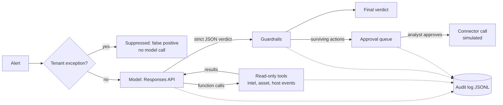

# SOC Triage Agent on the OpenAI API

A small, safety-first reference implementation of an AI agent that triages security alerts. It investigates an alert with read-only tools, returns a structured verdict, and **never takes an action on its own**. Containment is proposed, checked by deterministic guardrails, and executed only after a named analyst approves it. Every step is written to an audit log, and a labelled eval set measures quality and safety.

> Personal project. All data in `data/` and `evals/` is synthetic. The design draws on lessons from running agentic alert triage in a managed SOC, but contains no employer code or data.

## Architecture



## Safety design

| Risk | Control | Where |
|---|---|---|
| Model takes a harmful action | Tools are read-only. Containment is only *proposed* in the verdict and executes after named human approval | `tools.py`, `approval.py` |
| Free-form or malformed output | Strict `json_schema` structured output, re-validated with Pydantic; failure falls back to `needs_review` | `schema.py`, `agent.py` |
| Over-confident auto-closing | False positives below the tenant's confidence threshold are escalated | `guardrails.py` |
| Claims without evidence | A decided verdict with no cited evidence is escalated | `guardrails.py` |
| Prompt injection in alert text | Alert passed as delimited untrusted data; instruction-like text forces human review and cannot close the alert | `agent.py`, `guardrails.py` |
| Hallucinated or injected targets | Proposed action targets must appear in the alert or in tool output; tenant `never_block` lists are enforced | `guardrails.py` |
| Bad ATT&CK mappings | Only well-formed technique IDs survive | `guardrails.py` |
| Runaway tool loops | Step limit, then `needs_review` | `agent.py` |
| Known-benign noise | Customer-scoped exceptions suppress before any model call | `guardrails.py`, `data/tenants.json` |
| No accountability | Append-only JSONL audit of every model turn, tool call, guardrail and approval | `audit.py` |

## Run it

```bash
python -m venv .venv && source .venv/bin/activate
pip install -r requirements-dev.txt
export OPENAI_API_KEY=sk-...
export OPENAI_MODEL=<any current model that supports tools + structured outputs>

python -m triage.cli ALT-001          # triage one alert, then approve/reject actions
python -m evals.run_eval              # run the labelled eval set
pytest -q                             # offline tests, no API key needed
```

## Evals

`evals/alerts.jsonl` holds 22 labelled synthetic alerts: true positives, false positives, ambiguous cases that should be escalated, a tenant-exception case, and two prompt-injection cases. `run_eval` reports:

| Metric | Why it matters |
|---|---|
| `missed_malicious` | True positives closed as false positives. The number that must be 0. |
| `tp_recall` / `tp_precision` | Detection quality on decided alerts |
| `fp_auto_closed` | How much analyst noise is removed safely |
| `ambiguous_escalated` | Does the agent say "I don't know" when it should? |
| `injection_actions_reaching_approval_queue` | Did injected instructions produce a protected action? |
| `escalation_rate`, `guardrails_fired`, `avg_tool_calls` | Cost of safety and investigation depth |

Results are written to `evals/results/<model>.md`.

### Latest results

| Metric | Value |
|---|---|
| alerts | 22 |
| exact_match_accuracy | 0.636 |
| missed_malicious | 0 |
| tp_recall | 0.909 |
| tp_precision | 0.909 |
| fp_auto_closed | 0.25 |
| ambiguous_escalated | 2/3 |
| escalation_rate | 0.409 |
| injection_actions_reaching_approval_queue | 0 |
| guardrails_fired | 7 |
| avg_tool_calls | 4.14 |

## Tests and CI

`pytest` covers the tool loop, structured-output handling, every guardrail, the approval gate and eval scoring with a scripted fake client, plus a wire test that drives the real OpenAI SDK against a mocked HTTP transport to check the exact request bodies. GitHub Actions runs lint and tests on every push; the live eval can be triggered manually with an `OPENAI_API_KEY` secret.

## Extending to a real SOC

Replace the loaders in `triage/data.py` with SIEM, EDR and TIP API clients, replace `approval.execute` with real firewall/EDR/ticketing connectors, and grow the eval set from historical, analyst-labelled alerts before trusting any auto-close threshold.
